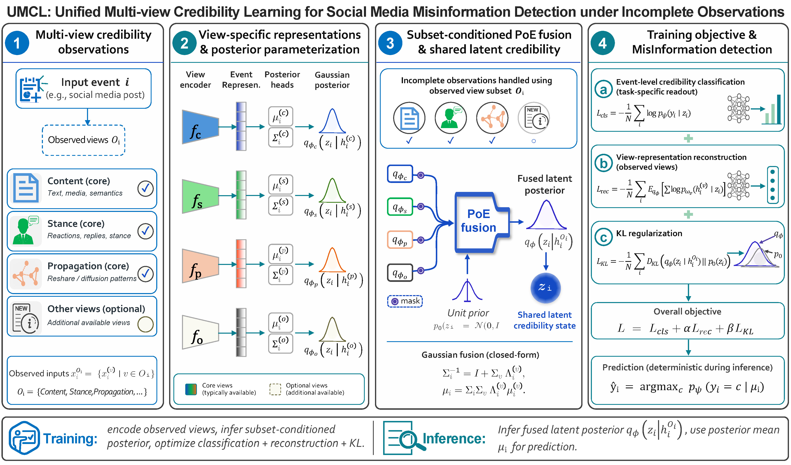

# UMCL

Research code for **Unified Multi-view Credibility Learning (UMCL)**. UMCL models
online credibility from complementary content, stance, propagation, evidence,
and source views. View-specific representations are combined through a
Product-of-Experts fusion module for event-level classification. 

We formulate social media misinformation detection as a multi-view credibility learning problem. UMCL represents heterogeneous event-level views as probabilistic evidence of a shared latent credibility construct and employs subset-conditioned Product-of-Experts fusion to integrate whichever views are available. This design provides a common inference interface for incomplete and varying view configurations without explicit view imputation or subset-specific fusion architectures.




## Supported datasets

- PHEME
- Twitter15
- Twitter16
- Weibo

Please obtain each dataset in accordance with its original license and place the
raw files under `data/downloads/`. Preprocessed datasets already present under
`data/preprocessed/` are reused automatically.

## Requirements

- Python 3.12+
- PyTorch 2.7+


## Usage

Run the complete preprocessing, training, validation, and test pipeline:

```bash
python run_umcl_pipeline.py --dataset_id PHEME --seed 2
```

The pipeline builds missing view artifacts, selects the best checkpoint on the
validation set, and evaluates it once on the test set. Model and optimization
settings are defined in `config/config.json`; outputs are written to
`runs/<dataset>/seed_<seed>/`.

To run preprocessing separately:

```bash
python preprocess/preprocess_events.py --dataset_id PHEME
python preprocess/preprocess_views.py --dataset_id PHEME --views all
```

Evaluate an existing checkpoint:

```bash
python test_umcl.py \
  --dataset_id PHEME \
  --checkpoint runs/PHEME/seed_2/<run_id>/checkpoint_best.pt
```

Use `--pretrained_model <model_name_or_path>` to replace the default
`xlm-roberta-base` backbone.

## Repository structure

```text
config/                    Experiment configuration
preprocess/                Event and view preprocessing
models/encoders/           View-specific encoders
models/fusion/             Multi-view fusion and training
run_umcl_pipeline.py       Main experiment entry point
test_umcl.py               Checkpoint evaluation
```

## Reproducibility

The default random seed is `2`. Reported runs should record the dataset, seed,
configuration, pretrained model, and generated `run_config.json`.

## Citation

If you use this code, please cite the accompanying paper. Citation metadata will
be added upon publication.
